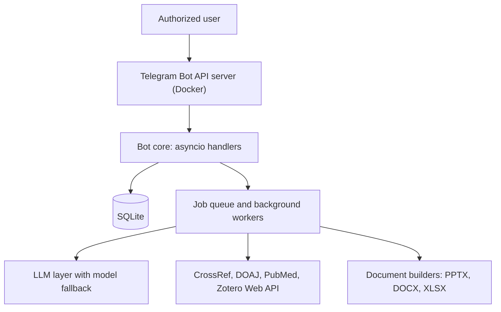

# Samery

A personal Telegram assistant that started as a music archiver and grew into a full toolbox for research, documents, content and everyday automation. I designed and built it for myself, and I run it as a managed service on my own machine.

> **The source code is private.** This repository is a public overview of what it does and how it is built. I'm happy to walk through the design on request.

## Highlights

- **Pluggable LLM layer.** Gemini by default, any OpenAI-compatible endpoint, automatic model fallback.
- **Reference checking.** Matches in-text citations to a reference list and verifies entries against CrossRef and DOI. Anything it cannot verify is reported as "not found", never as "fake".
- **Slide generator.** An LLM plans a JSON spec that is validated against a schema and rendered to PPTX: right-to-left layout, native charts and tables, user-supplied fonts, and an image library whose pictures are tagged by a vision model and de-duplicated.
- **Evidence extraction for theses.** Pulls studies from PubMed into a structured evidence map.
- **Zotero integration.** Sends references to one or more Zotero libraries through the Web API.
- **Background work.** Job queue, scheduler, reminders and price alerts.

## Commands

### Music
- `/search` find a song (YouTube first, then free-licensed sources)
- `/sc`, `/yt` search SoundCloud and YouTube
- `/playlist` download a whole playlist (audio or video)
- `/stems` separate vocals from the instrumental
- `/cut` trim a section of a track
- `/enrich`, `/lyrics`, `/cover` cover art, lyrics and release dates
- `/library`, `/recent`, `/stats` the download archive
- `/suggest` a song suggestion, sent automatically every morning

### Video
- Send a video and get a 9:16 reel with Persian subtitles
- Download from Instagram, TikTok and YouTube (video or audio only)
- Pull a video's full transcript
- `/vcut` trim a video

### Research
- Send a PDF and get a summary, translation and Q&A on its content
- `/paper` find a paper and an APA citation
- `/journal` find a journal to publish in
- `/lit` literature review with Excel or Word output
- `/thesis` evidence extraction from PubMed
- `/defense` mock thesis defense with three examiners
- `/review` critical review of a paper
- `/refcheck` check and match references
- `/refs` export RIS, BibTeX or Zotero entries from a DOI or PMID
- `/retract` check whether cited papers have been retracted
- `/zotero` manage Zotero accounts and send sources

### Content
- `/style` then `/script` reel scripts in your own voice
- `/content` Instagram captions and carousels
- `/post`, `/posts` schedule channel posts
- `/img` generate and edit images
- `/deck` build a PowerPoint deck, with RTL layout, your own fonts and an image library
- `/imglib` manage the slide image library, `/fonts` manage fonts

### Learning
- `/interview` mock programming interview
- `/en` polish text into academic English
- `/words`, `/vocab` extract and review vocabulary

### Tools
- `/make` build Word, PowerPoint, Excel or HTML files
- `/tr` translate
- `/remind` reminders
- `/pdf` make a PDF from a link or file path, `/scan` turn photos into one tidy PDF
- Send a photo with the caption `ocr` to extract its text
- Send a voice note to get it transcribed

Downloads are meant for personal use of content the user is entitled to access.

## Architecture

## Stack

| Area | Choices |
| --- | --- |
| Language and runtime | Python, asyncio |
| Bot layer | python-telegram-bot, self-hosted Telegram Bot API server in Docker |
| Work model | Job queue for heavy tasks, 9 background workers |
| Reliability | Flood-control and rate-limit handling with retries, graceful degradation when an external lookup fails |
| Storage | SQLite |
| Integrations | httpx, CrossRef, DOAJ, PubMed, Zotero Web API, Gemini and OpenAI-compatible LLM APIs |
| Documents and media | python-pptx, Pillow, yt-dlp, ffmpeg |
| Operations | Runs as a launchd service on macOS, with logging |

About 17.6K lines of Python and 50+ commands.

## Design principles

- **One authorized user.** Every update from anyone else is ignored.
- **Secrets stay in the environment**, never in code or logs.
- **Verify instead of guess.** Lookups that can be checked are checked, and the bot states what it could not verify.
- **No invented facts in generated documents.** Numbers and citations must come from the supplied source.

## Related public work

- [persian-cover-engine](https://github.com/omidalighadr/persian-cover-engine): Persian (RTL) cover-image library and CLI, typed and tested.

## Contact

GitHub: [@omidalighadr](https://github.com/omidalighadr)
