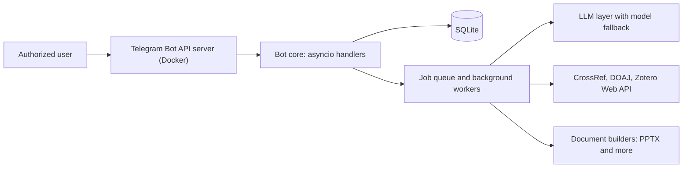

# Samery

A single-user AI assistant that lives in Telegram. I designed and built it to take over the research, document and automation chores I kept doing by hand, and I run it as a managed service on my own machine.

> **The source code is private.** This repository is a public overview of what it does and how it is built. I'm happy to walk through the design on request.

## What it does

- **Answers and analyses.** Questions, documents and links in, structured answers out. A pluggable LLM layer (Gemini by default, any OpenAI-compatible endpoint) with automatic model fallback.
- **Checks references.** Matches in-text citations to a reference list and verifies entries against CrossRef and DOI. Anything it cannot verify is reported as "not found", never as "fake".
- **Finds publication venues.** Suggests journals only where comparable papers were actually published, using CrossRef and DOAJ data.
- **Builds slide decks.** An LLM plans a JSON spec that is validated against a schema and rendered to PPTX: right-to-left layout, native charts and tables, user-supplied fonts, and an image library whose pictures are tagged by a vision model and de-duplicated.
- **Connects to Zotero.** Adds references to one or more Zotero libraries through the Web API.
- **Handles background work.** Job queue, scheduler, reminders and price alerts.

## Architecture

## Stack

| Area | Choices |
| --- | --- |
| Language and runtime | Python, asyncio |
| Bot layer | python-telegram-bot, self-hosted Telegram Bot API server in Docker |
| Work model | Job queue for heavy tasks, 9 background workers |
| Reliability | Flood-control and rate-limit handling with retries, graceful degradation when an external lookup fails |
| Storage | SQLite |
| Integrations | httpx, CrossRef, DOAJ, Zotero Web API, Gemini and OpenAI-compatible LLM APIs |
| Documents | python-pptx, Pillow |
| Operations | Runs as a launchd service on macOS, with logging |

About 17.6K lines of Python and 50+ commands.

## Design principles

- **One authorized user.** Every update from anyone else is ignored.
- **Secrets stay in the environment**, never in code or logs.
- **Verify instead of guess.** Lookups that can be checked are checked, and the bot states what it could not verify.
- **No invented facts in generated documents.** Numbers and citations must come from the supplied source.

## Related public work

- [persian-cover-engine](https://github.com/omidalighadr/persian-cover-engine): Persian (RTL) cover-image library and CLI, typed and tested.

## Contact

GitHub: [@omidalighadr](https://github.com/omidalighadr)
