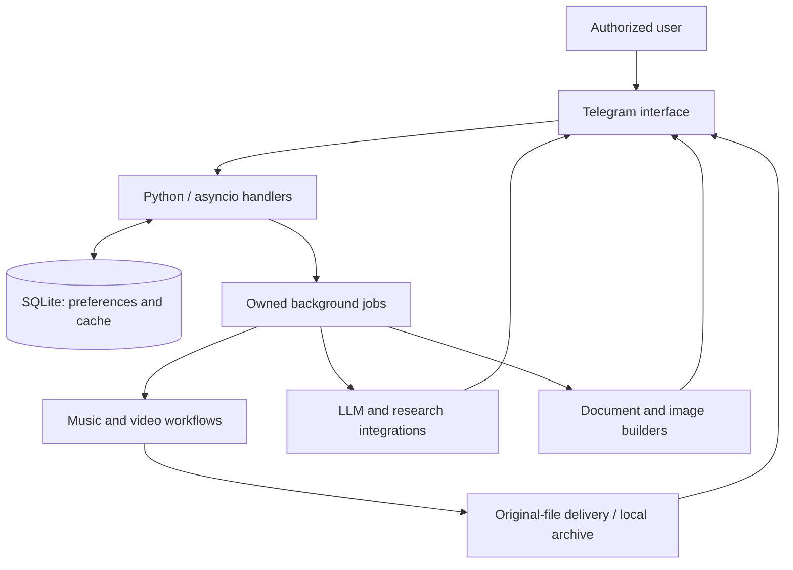

# Samery

### A personal Telegram assistant for media, research and everyday automation

Samery combines original-quality music and video workflows with AI, research and document tools. It runs as a private Python application with an English interface, background jobs and persistent local storage.

> **Public showcase only.** This repository describes the product and its architecture. Application source code, account sessions, credentials, databases and media files are not published here.

## At a glance

| Area | What Samery does |
| --- | --- |
| Music | Lossless FLAC workflows, artwork, available lyrics and channel-ready metadata |
| Video | Best-available YouTube video and audio, including 4K/8K when offered by the source |
| Experience | English menus, confirmation cards, progress updates, cancellation and library navigation |
| Research | Document Q&A, reference checking, PubMed evidence extraction and Zotero integration |
| Content | Presentations, document generation, image tools and scheduled posts |
| Operations | Background task ownership, SQLite persistence and a managed macOS service |

## Recent improvements

### Original-quality music

Apple Music workflows select the best available lossless source and produce FLAC while preserving the source sample rate and bit depth. A compressed source is not presented as lossless simply because it has been converted to FLAC.

Track delivery includes clean artist/title filenames, cover art and source metadata. Lyrics are embedded or delivered separately when the source provides them. Caption preferences let the user show or hide the artist, duration, release date, disc and track number, source ID, audio quality and channel signature.

Music requests support preview cards, saved-library navigation and repeat delivery from cached Telegram files where available. New album downloads keep a separate library entry for each track.

### Best-available YouTube video

The video workflow selects the highest available resolution and the best audio stream, then merges them without re-encoding. It has no resolution or file-size preference that silently substitutes a smaller version. Source frame rate and HDR information are retained when available.

- **4K and 8K support:** subject to the formats exposed for the video and the current connection/account.
- **Original file delivery:** uploaded as a document with the actual resolution, frame rate and size.
- **Background execution:** progress updates and cancellation without blocking other conversations.
- **Clear size handling:** files above the configured Telegram upload limit remain intact on local storage; quality is not reduced automatically.

The current setup uses the standard Telegram Bot API. A higher-capacity delivery transport is supported but requires separate configuration; it is not assumed to be active.

### A cleaner Telegram experience

The main keyboard has six destinations:

| Apple Music | Search Music | My Library |
| --- | --- | --- |
| Downloads | Tools | Settings |

Existing research, document, video, content and learning tools remain accessible through the tools hub. A single editable status shows download stages instead of leaving a trail of progress messages. Confirmation and cancellation controls stay associated with the relevant request.

## AI, research and documents

- **Flexible LLM integration:** Gemini and OpenAI-compatible endpoints, with model fallback.
- **Document workflows:** summaries, translation and questions grounded in supplied files.
- **Reference checking:** citation/reference matching and CrossRef/DOI verification; an unverified lookup is reported as not found, rather than automatically labeled fake.
- **Research support:** PubMed evidence extraction, reference exports and Zotero library integration.
- **Presentations:** schema-validated plans rendered to PowerPoint with RTL layouts, native charts, tables, custom fonts and an image library.
- **Everyday tools:** reminders, scheduled posts, image utilities and learning workflows.

## Architecture

Long-running work is separated from update handling. Delivery respects the configured transport limit, while completed oversized files are retained for later access. The macOS service starts independently of an open Terminal window.

## Technology

| Layer | Stack |
| --- | --- |
| Application | Python, asyncio, python-telegram-bot |
| Persistence | SQLite, cached file identifiers, per-user and per-chat preferences |
| Media | yt-dlp, FFmpeg, embedded tags, artwork and lyrics |
| APIs & research | httpx, Gemini, OpenAI-compatible APIs, CrossRef, PubMed, DOAJ, Zotero |
| Documents & images | python-pptx, Pillow, structured generation plans and RTL layouts |
| Reliability | Background job ownership, cancellation, timeouts, retries and controlled error messages |
| Operations & checks | macOS launchd, pytest, Ruff, dependency and legacy-feature checks |

## Validation and practical limits

The latest locally validated build, checked in **October 2026**, passed **199 regression tests** alongside dependency, lint, formatting and legacy-feature checks. These are application checks performed against the private implementation; this showcase does not claim to host its source or CI pipeline.

Video verification included a real **3840×2160, 60 fps** source with audio, checked with FFprobe. Format-selection tests also cover choosing an available 8K stream over smaller alternatives. This distinguishes live media verification from synthetic selector tests.

Availability depends on source access, account/session validity, network conditions and the formats actually exposed by the provider. Lyrics and artwork are shown when available. Telegram upload limits still apply, and a local macOS deployment requires the machine to be running and connected.

## Selected commands

| Command | Purpose |
| --- | --- |
| `/start`, `/menu` | Open the main interface |
| `/apple`, `/codec`, `/amlyrics` | Apple Music, source quality and lyric preferences |
| `/video` | Download a YouTube video at the best available quality |
| `/search`, `/sc`, `/yt` | Music discovery and source search |
| `/playlist`, `/stems`, `/cut` | Collection, audio separation and trimming workflows |
| `/deck`, `/make`, `/pdf`, `/scan` | Presentations, documents and PDF tools |
| `/refs`, `/refcheck`, `/thesis`, `/zotero` | Reference and research workflows |
| `/cancel` | Stop active work |

Media workflows are intended for content the user is entitled to access.

## Related work

**[persian-cover-engine](https://github.com/omidalighadr/persian-cover-engine)** — an open-source Python library for Persian cover images, RTL shaping, text fitting and contrast-checked layouts.

## Author

Built and maintained by **[Omid Alighadr](https://github.com/omidalighadr)**.
