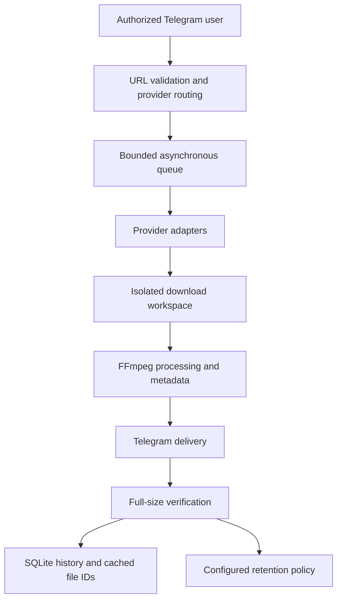

# Samery Media

### Source-aware media workflows, delivered through Telegram.

A focused Python application for Apple Music, YouTube, Instagram and SoundCloud. Built around media integrity, clear job status and recoverable delivery.

**Private beta** · **Private implementation** · **Public engineering showcase**

[Creator](https://github.com/omidalighadr) · [Telegram bot — restricted access](https://t.me/SameryMediaBot)

## The product

Send a supported link. Samery Media validates the source, queues the request, processes the best accessible media and delivers the result with clean filenames, artwork and accurate metadata where available.

English menus, progress updates, cancellation, download history, favorites and cached resend keep the workflow inside Telegram. Oversized originals are retained for retry instead of silently reducing quality.

## Provider capabilities

| Provider | Implemented workflow | Integration status |
| --- | --- | --- |
| Apple Music | Lossless ALAC source to FLAC, PCM verification, cover art and available lyrics | Requires a subscribed account, valid session and running local wrapper; latest standalone-bot end-to-end acceptance remains pending |
| YouTube | Best available source streams, including 4K when offered; stream-copy merging and compatible MP4 delivery | Live format discovery checked; media conversion and delivery logic covered offline |
| Instagram | Video posts and reels, best accessible stream, native Telegram video delivery where compatible | Used in the private beta; access depends on the source and session |
| SoundCloud | Tracks, playlists and supported Discover sets; original upload when accessible, otherwise best available full stream | Live track download and playlist resolution verified |
| Spotify | Isolated lossless-only single-track adapter | Experimental; required account/device setup and live acceptance are pending |

## Apple Music: lossless integration

Implemented an Apple Music lossless pipeline through **existing open-source decryption-wrapper tooling**, integrated with Gamdl. The engineering work covers orchestration, runtime readiness, failure handling, metadata, delivery and audio-integrity validation.

The pipeline accepts a lossless ALAC source, preserves its sample rate and bit depth, then verifies decoded PCM hashes before and after FLAC conversion. A lossy AAC stream is never converted and advertised as lossless.

This work credits the upstream decryption implementation; it does not claim an independently discovered DRM vulnerability.

## Quality is a property of the source

- **Audio:** report the actual codec, sample rate and bit depth. SoundCloud output retains its real source format.
- **Video:** choose the best available streams and remux without recompression where compatible. Resolution is limited by what the provider exposes.
- **Presentation:** clean artist/title filenames, artwork, duration and available disc/track metadata.
- **Persian subtitles:** an explicit button requests Gemini transcription/translation, a reusable SRT and a separately rendered subtitled MP4. This rendering re-encodes video; the original remains a separate artifact. Live translation acceptance after the latest fix is pending.

## Architecture

Provider adapters stay separate from Telegram interaction. One worker processes a bounded FIFO queue, with per-user limits and cancellation that stops the owned subprocess group. SQLite persists job history and bot-specific Telegram file identifiers.

Delivery checks the returned file size against the complete local artifact. The implemented retention policy removes eligible temporary files only after verified delivery and saved resend identifiers; owner files and failed deliveries are retained. Deployment of the latest retention policy is pending.

## Validation

The private implementation passed **89 offline regression tests** in the latest local run, plus Ruff checks. Coverage includes access control, URL handling, queue lifecycle, cancellation, retention safeguards and delivery failures. Real FFmpeg fixtures check stream-copy behavior and subtitle rendering; network services and translation are mocked in those tests.

Live checks include YouTube format discovery, a SoundCloud AAC/M4A download with embedded cover art and resolution of a 20-item personalized SoundCloud set. These checks are distinguished from complete provider-account and Telegram acceptance tests. This public repository contains documentation, not the private test suite or a public CI build.

## Stack and operation

**Python · asyncio · python-telegram-bot · httpx · SQLite · yt-dlp · FFmpeg / FFprobe · Mutagen · Pillow · pytest · Ruff**

Runs as a macOS LaunchAgent independently of an open Terminal window. The host must remain awake and connected. Current storage is local; cloud storage is not active. Source access, account sessions and Telegram transport limits still apply.

Credentials, cookies, databases, downloaded media and application source stay outside this repository.

## Upstream foundations

Samery Media integrates established open-source projects, including [yt-dlp](https://github.com/yt-dlp/yt-dlp), [FFmpeg](https://ffmpeg.org/), [python-telegram-bot](https://github.com/python-telegram-bot/python-telegram-bot), [Gamdl](https://github.com/glomatico/gamdl) and an existing Apple Music decryption wrapper. The experimental Spotify adapter integrates [Votify](https://github.com/glomatico/votify). These projects retain their respective authorship and licenses.

---

Built and maintained by [Omid Alighadr](https://github.com/omidalighadr).
